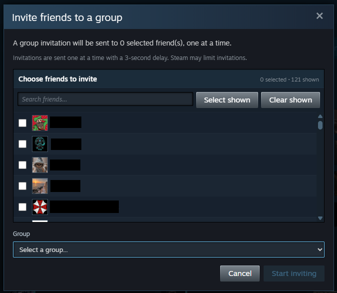

<p align="center">

</p>

# Steam Page Tools

Steam Page Tools is an unofficial browser extension for Chrome and Firefox that adds cross-page badge tools, friends-page comments and group invitations, inventory valuation and reviewed bulk actions, active market listing tools, and bulk Store actions directly to Steam.

It is designed for people who manage large badge libraries, compare card-drop status across many pages, or want to select several Store results before adding them to a cart or wishlist.

> **Unofficial project:** Steam Page Tools is independent and is not affiliated with or endorsed by Valve Corporation. Steam and the Steam logo are trademarks of Valve Corporation.

## Features

### Settings popup


Click the extension icon to enable or disable Steam Page Tools as a whole or configure each feature area separately: profile tools (SteamSets shortcut and clearing comments on your own profile), badge tools, friends tools, inventory tools, market listings, and Store bulk actions. All options are enabled by default. Reload an already-open Steam page after changing a setting.

### Profile tools


On Steam Community profile pages, Profile tools adds a SteamSets shortcut. On your own profile or `allcomments` page, it also adds a compact `Clear all comments` link beside Steam's comment controls. The tool loads the current comment total and asks for confirmation before deleting comments one at a time with an 800-millisecond delay. It prevents a second tab from running simultaneously, can be stopped after the current request, and stops rather than retrying a rejected deletion.

> [!WARNING]
> Clearing profile comments cannot be undone.

### Badge pages


On every Steam Community profile badge page:

- Search owned badges by game or badge name across every paginated result. Matching badges appear progressively as each source page is scanned, and Steam's original pagination is hidden until the search is cleared.
- Open the SteamSets badge-search page in a new tab from the badge toolbar.

On the signed-in user's own badge pages:

- Count games with card drops remaining across every paginated badge result.
- Show only games with card drops remaining across paginated badge results.
- Auto-craft complete card sets across your badge pages, with confirmation, live progress, request pacing, rate-limit handling, cross-tab protection, safety limits, and a stop-after-current-request control.

> [!WARNING]
> Auto-crafting consumes cards and cannot be undone. The extension asks for confirmation before crafting begins.

### Friends page




On the signed-in user's friends page:
- Open a Steam-styled dialog, search the friends list, and explicitly choose which profiles should receive the reviewed comment. Recipients start unselected until you pick them; the last selection is restored the next time you open the dialog.
- Invite selected friends to a group returned by Steam's own group-invite picker. Group invitations are available only on your own friends page and require a separate confirmation.
- Follow live posted, skipped, and failed counts, progress, and the current profile.
- Wait three seconds between comments, skip profiles that do not allow comments, wait 20 seconds after other failures before continuing, and retry bounded cooldown responses after a randomized 10-to-15-second delay (or Steam's longer `Retry-After` value).
- Send group invitations one at a time with a three-second delay, including after ordinary failures; report duplicates, stop on Steam cooldowns, and stop safely after the current request.
- Stop safely after the current request and prevent duplicate runs across Steam tabs.

The extension asks for confirmation before a run begins. Comment and invitation recipient selections are saved separately on Steam and restored for their next respective run. Comments already posted remain on the recipient profiles if a run is stopped.

### Steam inventory


On Steam Community inventory pages, the extension:

- Loads all available inventory tabs and pages while preserving stack quantities and reporting partial failures.
- Values marketable items with current Steam Community Market data, including lowest-listing and quick-sale estimates, fees, seller net, recent price history, pricing coverage, and per-game totals.
- Adds compact price badges to Steam's own item tiles and a detailed estimate to Steam's selected-item pane instead of displaying a separate inventory table.
- Keeps totals in a narrow native-style strip; search, pricing filters, selection totals, and review controls stay inside a collapsed `Show tools` drawer. Item selection is enabled only while that drawer is open and is cleared when it closes.
- Uses the signed-in account's Steam wallet currency for Market requests, calculations, inputs, and display, with all official Steam currency IDs supported. Prices are cached for 15 minutes by currency, country, game, and market name. Refresh and cancellation controls remain available.

Bulk selling and conversion to Gems are available only for the signed-in user's own inventory. Open `Show tools`, click Steam's item tiles to toggle their selection, review the proposed batch, and confirm it once before sequential processing begins. `Quick sell` targets the refreshed highest buy order for one unit from each selected asset or stack; it does not undercut the lowest listing, and items without a current buy order are visibly explained and excluded from review. The workflow rechecks ownership, eligibility, and price or Gems value immediately before every request, skips a quick sale if its buy order changed, stops on rate limits, never blindly retries a mutation, and blocks uncertain operations until the page is reloaded.

> [!WARNING]
> Inventory valuations are estimates, not guarantees. Steam's final price, fees, eligibility, restrictions, and any required mobile or email confirmations are authoritative. Selling or converting an item to Gems can be irreversible.

### Steam Community Market


On the Steam Community Market home page (`https://steamcommunity.com/market/`):

- Add selection checkboxes to each active listing row and a `Select all shown` control with a live selection counter.
- Bulk cancel and remove selected listings from the Market with confirmation, polite pacing, 429 rate-limit backoff, and a safe stop control.
- Bulk edit prices and relist selected items:
  - Unified price adjustments: set a fixed buyer price or apply a percentage modifier across all selected items.
  - Individual per-item buyer price inputs with live seller net fee calculations ("You receive").
  - Sequential cancel-and-relist execution: cancels the active listing, locates the returned asset in the user's inventory, and relists it at the reviewed price with live progress tracking and a stop control.

### Steam Store search results


<br>
<br>


- Select games directly from the search results.
- Add selected games to the cart in one run.
- Add selected games to the wishlist after refreshing the account's current wishlist; games already on it are skipped automatically.
- On a wishlist page, clear the signed-in account's entire wishlist after confirming Steam's displayed item count. The extension uses Steam's native remove controls one at a time, so Steam retains control of authentication and rate limits.

Bundle rows are not supported. When a game has multiple purchase options, the cart action uses Steam's first/default package.

## Where it runs

The extension is limited to these Steam page patterns:

```text
https://steamcommunity.com/my/friends*
https://steamcommunity.com/my/inventory*
https://steamcommunity.com/market/*
https://steamcommunity.com/id/*
https://steamcommunity.com/profiles/*
https://store.steampowered.com/search*
https://store.steampowered.com/wishlist/*
```

It does not request access to every website, a background process, or a service worker. Its toolbar popup uses only the WebExtension `storage` permission to retain feature on/off settings.

| Browser | Minimum version |
| --- | ---: |
| Chrome | 111 |
| Firefox | 140 |

Firefox 140 or later is required so Firefox can display its built-in consent UI for the data categories declared by the extension.

## Privacy

Steam Page Tools has:

- no telemetry or usage analytics;
- no advertising;
- no remote JavaScript;
- no developer-operated server; and
- no developer collection or retention of Steam account data.

The extension processes relevant Steam page and account state locally. Session identifiers and action parameters are transmitted only to Steam when needed for a user-requested operation. Feature on/off preferences use extension-owned local storage. Inventory price data, Store selections, friends-comment recipients, and the short-lived crafting and friends-comment locks use storage owned by the corresponding Steam origin.

See [PRIVACY.md](PRIVACY.md) for the complete disclosure.

## Source and development

The Chrome and Firefox packages are built from the same readable modular sources. The build uses Node.js built-ins for staging and ZIP creation and does not download runtime code. Its generated inventory bundle is a deterministic concatenation of the reviewed source modules.

For contributors:

```text
npm ci --ignore-scripts
npm run check
```

Node.js 24 or later is required. `npm run check` lints the source, validates manifests and packaged contents, builds both browser archives twice, compares them byte-for-byte, and performs a final validation pass.

Generated `dist/` content and installed dependencies are intentionally not committed.

Additional project documentation:

- [CHANGELOG.md](CHANGELOG.md) — version history
- [PRIVACY.md](PRIVACY.md) — data handling and retention
